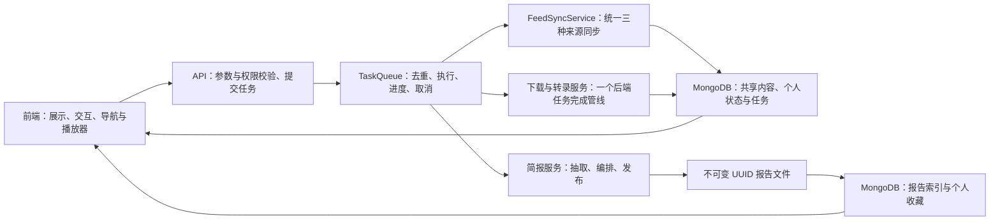

# 订阅、任务与简报工程改造

本次改造把内容同步、下载与转录的编排交给后端，保留传统收听与 AI 简报两种产品模式。遵循小步 TDD 和原子提交：每个业务单元先复现问题，再实现，再运行前端构建、前端测试与后端完整测试。

## 职责与数据流

前端负责输入、请求、分页、轮询和渲染。下载完成后开始转录、同步去重、是否允许处理、报告归属和收藏快照均由后端决定。前端的操作能力仅用于提示；写接口仍重新验证条件与权限。

保留 Flask、MongoDB 和 ThreadPoolExecutor，不引入消息中间件或通用工作流框架。当前任务执行、自动刷新和自动简报只支持一个执行进程；多个执行进程的租约与分布式锁需另立工程，不能把进程内去重当作分布式保证。

## 订阅与刷新

- 所有手动刷新入口都提交后端同步任务。列表重新加载只是完成后的展示更新。
- 手动与定时刷新使用同一同步服务，统一 GUID 去重、订阅元数据、错误和数据库累计节目数。
- 同一订阅的重复同步请求复用活动任务；操作完成后可再次刷新。
- 定时同步继续检查陈旧订阅。来源接口只返回近期内容时，刷新不会自动向更早历史无限回填。历史回填需单独定义范围、游标和限额。
- RSS 同批出现重复 GUID 也只入库一次。节目总数按已入库数据统计，不能用本次返回的条数覆盖。

## 处理结果与任务

节目保存的音频、文稿、摘要与任务进度分开表示：`artifacts` 表示产物，`active_tasks` 表示正在进行的操作，`actions` 表示当前可用动作及不可用原因。已有文稿的节目仍可能正在生成摘要，不能由文稿标记遮盖任务状态。

转录可显式请求 `download_if_needed=true`。一个后端任务先检查音频，必要时同步下载，再转录与保存；离开详情页不会中止管线，也不依赖浏览器收到下载完成事件。已有平台字幕仍可自动获取，本地转写继续由用户主动发起。

任务状态为 `pending`、`processing`、`completed`、`failed`、`cancelled`：

- 排队取消调用真实 Future.cancel，幂等返回，恢复节目可重试状态。
- 已经执行的不可中断调用不允许伪报取消；取消能力由后端返回，接口在点击时再次检查。
- 终态不再接受迟到的进度与状态覆盖。
- 重启后孤儿任务明确失败并恢复节目状态。系统不自动重复付费调用，用户检查后主动重试。
- 任务记录完成后按现有七天 TTL 清理；报告和收藏独立保存，不能依赖任务结果作为永久数据。
- 共享内容任务保持共享可读；个人简报任务按 owner 隔离。取消仍归提交者。

任务去重依据业务参数：同步按订阅，下载按节目，转录包含节目、服务商及影响结果的参数。参数不同的操作不能错误复用；终态之后允许重试。去重检查与提交在同一个队列锁中完成。

## 简报持久化与个人设置

简报生成与报告编排均保留在后端。生成完成后先写完整 UUID 文件，再登记 MongoDB 索引；文件或索引发布失败不能破坏已发布版本。历史扫描幂等补索引，历史分页按用户和时间查询，读取历史不会重新调用模型。

旧 `owner=None` 报告保持共享历史归属，不自动认领给第一个登录者。新个人报告、收藏和偏好按用户隔离。收藏由后端从可访问的报告提取可信快照，跨周期读取；不接受浏览器提供的任意正文作为报告内容。

旧浏览器收藏迁移只传条目 ID。无法找到或存在不同来源/正文歧义的 ID 返回 unresolved，并保留旧记录；重复迁移不重复创建收藏。布局偏好使用后端白名单并存在个人设置中，不进入全局 LLM 配置。

备份必须同时包含 MongoDB 与报告运行目录。恢复后可重建报告索引；只恢复 MongoDB 无法恢复文件正文。新增字段和集合采用兼容旧数据的增量方式，回滚代码前仍保留新报告与收藏数据。

## 界面边界

| 区域 | 业务职责 |
| --- | --- |
| 传统模式 | 订阅、节目、播放、文稿与摘要 |
| AI 简报模式 | 周/月报告、报告阅读、收藏与来源 |
| 简报侧栏 | 模式导航、周期和报告入口；五种内容模式放在报告页 |
| 工作台 | 已保存加工结果；正在处理的操作进入任务页 |
| 应用设置 | 全局配置与个人简报设置；返回原模式与阅读上下文 |
| 节目列表 | 后端分页、搜索和筛选，保留卡片基本设计 |
| 节目详情 | 保留直观操作，不将核心操作改成折叠面板 |

进入设置与返回保留原模式、周期、内容模式、标签及阅读位置。旧设置入口继续兼容。侧栏订阅和节目列表支持继续加载，不能只加载首批订阅或先取 500/1000 条再在浏览器筛选。

手机共用一致的菜单入口，隐藏低频设置，保留播放、阅读和任务的直接操作；播放器使用紧凑呈现，底部安全区与内容留白统一计算。任务在手机使用完整页面或面板，避免自动弹出遮住阅读内容。

## 验收边界

1. 并发刷新只执行一次；刷新完成新增节目可见，累计数正确。
2. 排队取消不执行 worker、不遗留处理中节目；运行任务不伪报取消。
3. 离开详情页后下载与转录继续；下载成功后转录失败保留可用音频，重试不重复下载。
4. 超过一页订阅、较早收藏、工作台筛选和节目搜索都可达，排序具有稳定 ID 次序。
5. 用户不能读取他人个人报告、收藏或简报任务；共享节目仍可读。
6. 发布失败保留上一报告；历史与收藏不受任务 TTL 影响；旧收藏歧义不丢失。
7. 两种模式各自进入设置后返回原上下文；五种内容模式不重复出现在侧栏。
8. 桌面与手机检查菜单、播放器遮挡、任务面板、直接阅读及详情操作。

自动测试采用 MockDB、模型和下载桩，不以真实付费调用验收。浏览器 fixture 验证必须明确与真实账号、真实模型端到端验证的区别。

## 本地数据校正

旧本地音频标记通过 `backend/scripts/reconcile_audio_metadata.py` 校正。默认仅预览，`--apply` 按实际文件存在性写 `has_local_audio`，不改音频文件或文稿；每条更新比较原路径、标记与更新时间，避免覆盖正在完成的下载。2026-10-01 本机预览检查827条，实际可用音频2条，过期路径0条；应用后再次预览为0条待修改。

此脚本可重复运行。下载目录搬迁后应先设置正确 `MEDIA_ROOT`，再预览与校正；回滚代码不删除音频、报告、收藏及个人偏好字段。
